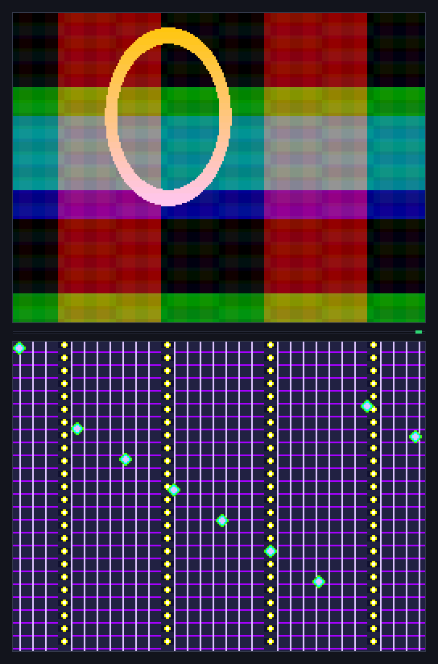
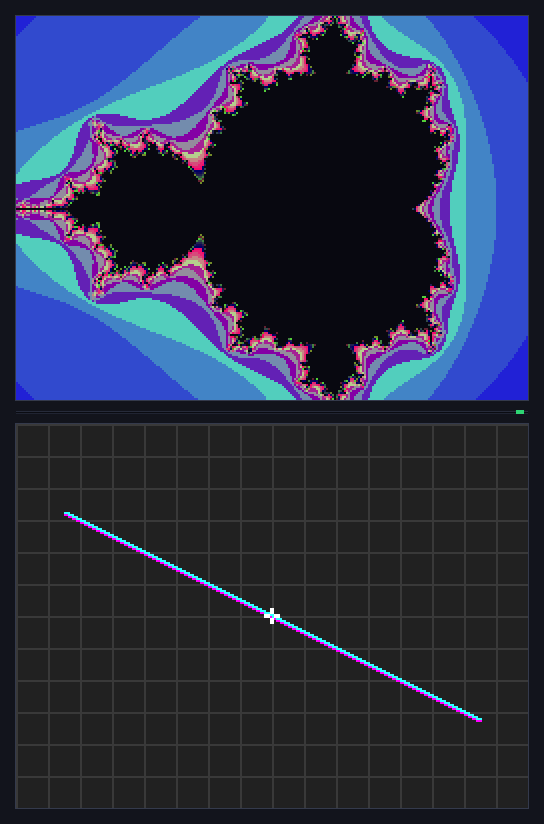
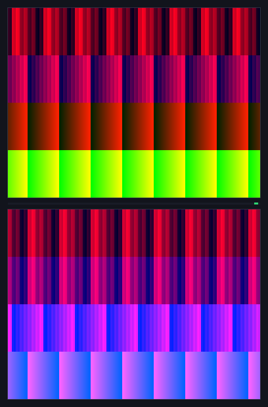

<div align="center">

# 🦀 DSRecomp

**Ahead-of-Time Nintendo DS (`ARM9`/`Thumb` + `BLZ Overlays` + `NitroFS`) → Safe Rust Static Recompiler**

[](https://github.com/Yzdraall/DSRecomp/actions/workflows/ci.yml)
[](#security--safety-guarantees)
[](https://www.rust-lang.org/)
[](./LICENSE-MIT)

*Transpile `.nds` cartridges directly into `#![forbid(unsafe_code)]` Cargo crates and native 60+ FPS Dual-Screen executables — **zero C++, zero CMake, zero external assemblers**.*

</div>

---

## ✨ Native AOT Dual-Screen Showcase (100% Clean-Room Built-In ROMs)

Every screenshot below was rendered by assembling a real CRC16-valid `.nds` cartridge from `ARMv5TE` + `Thumb` machine code (`dsrecomp demo --build-all`), transpiling its binary into `#![forbid(unsafe_code)]` Rust (`dsrecomp transpile`), compiling a native release binary via `cargo`, and running it headlessly:

| **`aurora_plasma.nds`** | **`mandelbrot_stylus.nds`** | **`overlay_quest.nds`** |
| :---: | :---: | :---: |
|  |  |  |
| **ARM9 ↔ Thumb `BLX` Interworking** + `NitroFS` `DMA3` scrolling 4bpp tilemap & 8 hardware OAM sprites | **Fixed-Point `Q12` Mandelbrot** (`SMULL`) on Top Screen + interactive **Mouse-to-Stylus** 15-bit canvas on Bottom Screen | **2 `BLZ`-Compressed Overlays** multiplexed at `0x02020000` + `LDRLS PC` switch jump-tables |

---

## 🚀 Why DSRecomp?

Traditional static recompilers (`N64Recomp`, `XenonRecomp`, `PS2Recomp`) emit raw C/C++ pointer soup and require a full CMake + Clang/MSVC build chain. Meanwhile, the **Nintendo DS (`NTR`)** introduces three notorious static-analysis hurdles that break naive lifters:

1. **Backward In-Place Compression (`BLZ` / `MIi_UncompressBackward`)**: Commercial NitroSDK games compress `arm9.bin` and overlays *backwards* from the end of the image. `DSRecomp` locates `_start_ModuleParams` (`0xDEC00621 0x2106C0DE`), preserves uncompressed `crt0` prefixes, unpacks `arm9.bin` and all `OVT` overlays in memory, and zeroes `compressed_static_end` just like real hardware.
2. **Per-Instruction `ARMv5TE` ↔ `Thumb` Interworking**: Functions freely alternate between 32-bit ARM and 16/32-bit Thumb via `BLX`, `BX`, `POP {.., PC}`, and literal-pool veneers. `DSRecomp` builds a mode-tagged `(addr, CpuMode)` Control-Flow Graph and resolves `LDRLS PC, [PC, Rn, LSL #2]` switch jump-tables statically.
3. **Overlapping Virtual RAM Overlays**: Because the DS has only `4 MiB` of Main RAM (`0x02000000..0x023FFFFF`), games map dozens of distinct overlays to the **same virtual address**. `DSRecomp` emits isolated Rust modules (`ov_0`, `ov_1`, …) multiplexed by active overlay ID at runtime, paired with a trace-guided auto-healer (`dsrecomp heal`) for computed indirect jumps.

| Capability | Traditional DS Emulator | C/C++ Static Recompilers | **DSRecomp (Rust)** |
| :--- | :---: | :---: | :---: |
| **Target Code Emission** | JIT / Interpreter | Raw `unsafe` C / C++ | **`#![forbid(unsafe_code)]` Rust Crate** |
| **Host Build Toolchain** | C++ / CMake / SDL | CMake + Ninja + Clang/MSVC | **`cargo build --release` only** |
| **NitroSDK `BLZ` Unpacking** | Runtime CPU loop | External Python/C tools | **Built-in pure Rust (`nitro-rom`)** |
| **Overlay VA Collisions** | RAM overwrite + JIT flush | Manual linker scripts | **Automatic `ov_N` Rust module router** |
| **Unmapped Indirect Jumps** | N/A | Crash / manual `symbols.toml` | **Hybrid continuity + `dsrecomp heal`** |

---

## ⚡ Quickstart (Zero Commercial ROM Required)

Clone the repository and recompile your first playable Dual-Screen Nintendo DS binary in under 30 seconds:

```bash
git clone https://github.com/Yzdraall/DSRecomp.git
cd DSRecomp

# 1. Assemble the 3 clean-room Nintendo DS (.nds) demo cartridges
cargo run --release -p dsrecomp -- demo --out-dir demos --build-all

# 2. Transpile a .nds ROM into a standalone #![forbid(unsafe_code)] Rust crate & launch the native desktop GUI!
cargo run --release -p dsrecomp -- transpile demos/mandelbrot_stylus.nds --out out/stylus_port --run

# Or run deterministically in headless mode and export a 2x Dual-Screen PNG:
cargo run --release -p dsrecomp -- transpile demos/plasma_dual.nds \
  --out out/plasma_port \
  --headless-frames 30 \
  --dump-png aurora_preview.png
```

### Desktop Native Controls (`egui` Frontend)
- **D-Pad**: `Arrow Keys` or `WASD`
- **A / B / X / Y**: `X` (or `Space`) / `Z` / `C` / `V`
- **L / R / Start / Select**: `Q` / `E` / `Enter` / `Tab`
- **Nintendo DS Touch Stylus**: **Click & drag with your mouse** directly on the bottom screen!
- **Live AOT Inspector**: Real-time `ARM9` register view, CPSR flags, active `ov_N` overlay indicator, and AOT vs. dynamic step counters.

---

## 🛠️ Working with Your Own Cartridges (BYO-ROM)

```bash
# Inspect header CRC16, NitroSDK version, BLZ ratios, Overlays & export the 32x32 game icon
dsrecomp inspect path/to/your_game.nds --export-icon icon.png

# List or extract assets from the embedded NitroFS (FNT + FAT) virtual filesystem
dsrecomp fs path/to/your_game.nds
dsrecomp fs path/to/your_game.nds --extract-to ./extracted_romfs

# Run full static interworking CFG + jump-table discovery across ARM9 & all Overlays
dsrecomp analyze path/to/your_game.nds

# Transpile into a standalone safe-Rust Cargo project + record indirect jump traces
dsrecomp transpile path/to/your_game.nds --out ./my_game_port --headless-frames 120 --trace-out trace.json

# Promote runtime-discovered indirect jump targets into 100% static AOT Rust
dsrecomp heal --rom path/to/your_game.nds --project ./my_game_port --trace trace.json
```

---

## 📊 Verified Benchmarks

Measured on Windows x86_64 (`rustc` stable, `--release`, thin-LTO):

| Workload | Binary Size / Scope | Static Discovery | Result / Speed |
| :--- | :--- | :--- | :--- |
| **Commercial BYO-ROM CFG Stress Test** (*Zelda: Phantom Hourglass*, `AZEE`, NitroSDK 4.0) | `64 MiB` ROM · `BLZ` `arm9.bin` (`268 KB → 397 KB`) + **62 `BLZ` Overlays** + `2,774` `NitroFS` files | **19,912 functions** (`846,297` ARM/Thumb insts · **7,283** `ARM↔Thumb` transitions · **1,214** jump-tables) | **`1.72 s`** total analysis |
| **`mandelbrot_stylus.nds` (AOT Native)** | `Q12` Mandelbrot + Mode 5 Stylus Canvas | `100.0%` AOT (`0` dynamic steps) | **`~500 – 1,400+ FPS`** headless |
| **`plasma_dual.nds` (AOT Native)** | `ARM9 ↔ Thumb BLX` + `DMA3` + OAM Sprites | `2` static fns (`ARM` + `Thumb`) | **`~600 – 1,050+ FPS`** headless |
| **`overlay_quest.nds` (AOT Native)** | `2` `BLZ` Overlays @ `0x02020000` + `2` Jump-Tables | `1` static fn + `2` overlay fns | **`~700 – 910+ FPS`** headless |

---

## 🏗️ Workspace Crate Architecture

```text
DSRecomp/
├── crates/
│   ├── nitro-rom/       # .nds header, CRC16-MODBUS, 4bpp Banner, BLZ codec, Overlays & NitroFS
│   ├── nitro-arm/       # ARMv5TE + Thumb decoders, UAL disassembler, CFG/jump-tables & assembler
│   ├── nitro-lifter/    # Sharded #![forbid(unsafe_code)] Rust AOT emitter & Overlay VA router
│   ├── nitro-runtime/   # ARM946E-S CPU, 4 MiB RAM/VRAM/OAM bus, DMA, SWI BIOS HLE & egui GUI
│   └── nitro-cli/       # `dsrecomp` binary (inspect, fs, analyze, transpile, heal, demo)
└── docs/
    └── ARCHITECTURE.md  # Deep-dive into BLZ, interworking CFG, Overlay multiplexing & healing
```

Read **[docs/ARCHITECTURE.md](docs/ARCHITECTURE.md)** for a full compiler deep-dive.

---

## 🔒 Security, Safety & Legal Notice

- **Memory Safety (`#![forbid(unsafe_code)]`)**: Every crate in `DSRecomp` — as well as every generated Rust game crate — strictly forbids `unsafe` blocks, enforces bounds-checked `NitroFS` path sanitization (`Zip-Slip` / `CWE-22` safe), and caps `BLZ` decompression allocations.
- **100% Clean-Room & BYO-ROM**: `DSRecomp` contains **zero** proprietary Nintendo SDK code, BIOS images, cryptographic keys, or copyrighted ROM data. All built-in `.nds` demos are procedurally assembled from scratch in Rust. Users must supply their own legally dumped cartridges.

## 📄 License

Dual-licensed under either **[MIT](LICENSE-MIT)** or **[Apache-2.0](LICENSE-APACHE)** at your option.
