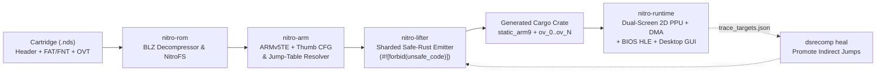

# DSRecomp Architecture & Compiler Internals

`DSRecomp` translates Nintendo DS (`NTR`) cartridge executables ahead-of-time (AOT) directly into **safe, standalone Rust Cargo crates (`#![forbid(unsafe_code)]`)** with zero C++, zero CMake, and zero external assembler toolchains.

---

## 1. Transparent Backward LZ77 (`BLZ`) Unpacking (`nitro-rom`)

Commercial Nintendo DS games built with NitroSDK compress both `arm9.bin` and dynamic `ARM9 Overlays` backwards from the end of the binary (`MIi_UncompressBackward`) so decompression can happen in-place inside the DS's 4 MiB Main RAM:

1. **`_start_ModuleParams` Discovery**: `nitro-rom` scans `arm9.bin` for the 8-byte magic signature `0xDEC00621 0x2106C0DE`. The preceding 28-byte structure exposes `compressed_static_end`, `.bss` bounds, and the exact NitroSDK version.
2. **In-Place Prefix Preservation**: The 8-byte BLZ footer at `compressed_static_end - arm9_ram_address` encodes both `header_len` (`bits[31:24]`), `compressed_len` (`bits[23:0]`), and `extra_len`. Bytes prior to `end - compressed_len` (the uncompressed `crt0` bootstrap stub) remain untouched while compressed tokens expand backwards from `end + extra_len` down to `end - compressed_len`.
3. **Zeroing `compressed_static_end`**: Just like NitroSDK's `crt0` routine on real hardware, `nitro-rom` zeroes `compressed_static_end` in the unpacked image so recompiled startup code never attempts to decompress itself a second time in RAM.

---

## 2. Dual-ISA `ARMv5TE` ↔ `Thumb` Interworking & Jump-Tables (`nitro-arm`)

Unlike MIPS (`N64Recomp`) or PowerPC (`XenonRecomp`), the Nintendo DS's `ARM946E-S` switches instruction sets dynamically between **32-bit ARM (`ARMv5TE`)** and **16/32-bit Thumb** on individual call and return instructions:

- **Mode-Tagged Worklist CFG**: Every basic-block leader and function seed in `ModuleCfg` is keyed by `(virtual_addr, CpuMode)`.
  - Immediate `BLX label` (`0xFA/0xFB` in ARM, or `0xF000 + 0xE800` in Thumb) flips `CpuMode` deterministically at the call edge while keeping the fallthrough return block in the caller's ISA mode.
  - Interworking veneers (`LDR R12, [PC, #imm]; BX R12`) are statically constant-folded from the literal pool, recovering `bit 0` (`1` = `Thumb`, `0` = `Arm`).
  - Thumb PC-relative loads (`LDR Rd, [PC, #imm8*4]`) and `ADR` (`ADD Rd, PC, #imm8*4`) enforce architectural word alignment `(PC + 4) & !3`.
- **Switch Jump-Table Recovery**: `nitro-arm` pattern-matches bounded dispatch sequences (`CMP Rn, #max_case` followed by `LDRLS PC, [PC, Rn, LSL #2]` or `ADDLS PC, PC, Rn, LSL #2`), reads all `max_case + 1` pointers directly from the binary section, strips interworking mode bits, and registers every case target as a basic-block leader.

---

## 3. Active Overlay Virtual-Address Multiplexing (`nitro-lifter`)

Because the Nintendo DS only has **4 MiB of Main RAM** (`0x02000000..0x023FFFFF`), games frequently compile dozens of `ARM9 Overlays` (`OVT`) that map into the **exact same virtual RAM window** at different points in gameplay (for instance, 62 distinct BLZ-compressed overlays in *The Legend of Zelda: Phantom Hourglass*).

A flat `match pc` dispatcher cannot distinguish `0x02080000` in `overlay_0` from `0x02080000` in `overlay_1`. `nitro-lifter` solves this cleanly:

1. Static `arm9.bin` functions are sharded (`150` functions per Rust file for fast parallel `rustc`/LLVM codegen) under `src/generated/static_arm9.rs`.
2. Each overlay `N` is lifted into its own isolated namespace `src/generated/ov_N.rs`.
3. `src/generated/mod.rs` checks `bus.active_arm9_overlay()` first, routing `(ov_id, pc, thumb)` to the currently loaded overlay module before falling back to `static_arm9`.
4. Within each function, intra-procedural loops and conditional branches compile to structured `loop { match block_pc { ... } }` state transitions (`block_pc = 0x...; continue;`), avoiding host call-stack growth on infinite 60 Hz game loops.

---

## 4. Hybrid Continuity & Trace-Guided Healing (`nitro-runtime` + `dsrecomp heal`)

Static analysis alone cannot foresee every computed function pointer (such as C++ virtual method tables or routines copied dynamically into `32 KiB ITCM` at `0x01FF8000`).

- Whenever `PC` lands on an address without a compiled AOT block, `nitro-runtime` seamlessly steps using its safe-Rust `ARMv5TE`/`Thumb` instruction executor until control reaches any compiled block or returns to its AOT caller.
- Any Main RAM code target (`0x02000000..0x023FFFFF`) reached dynamically is recorded with its active `overlay_id` and `CpuMode` into `trace_targets.json`.
- Running `dsrecomp heal --rom game.nds --project ./port --trace trace_targets.json` merges those targets into `recomp_manifest.json` and regenerates the Cargo crate, promoting dynamic targets into native AOT Rust functions.
